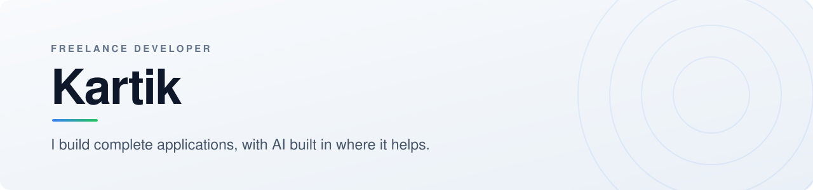
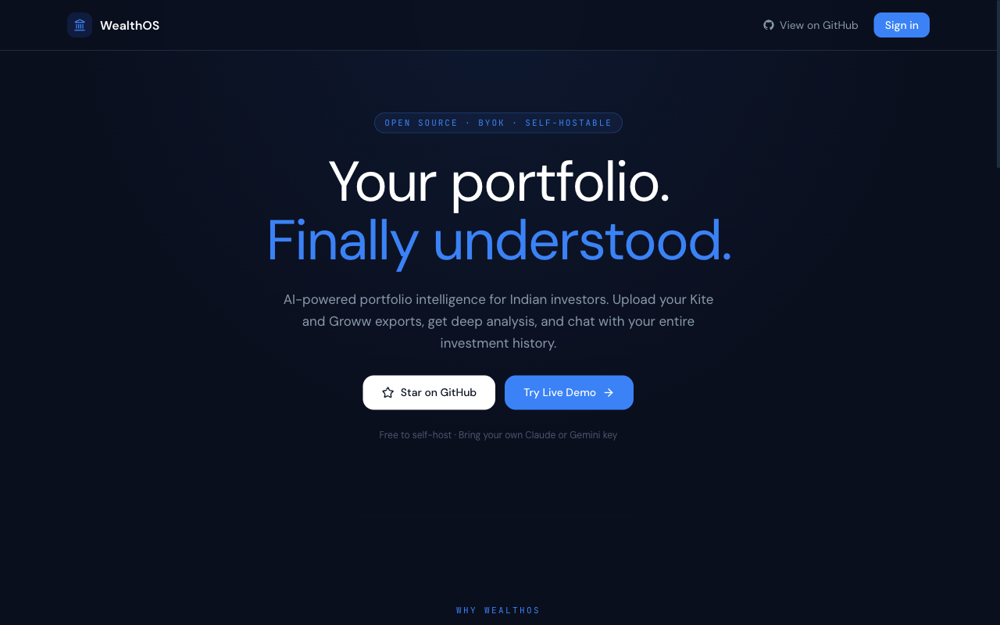
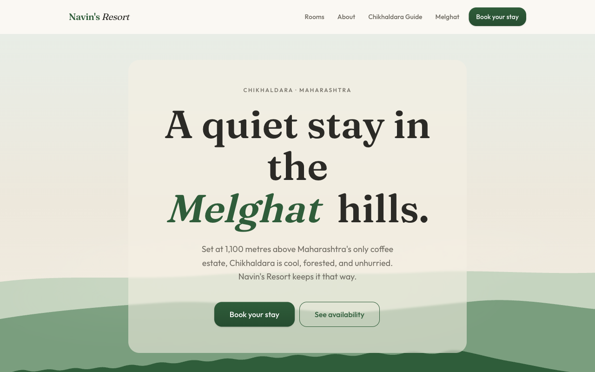

  <picture>
    <source media="(prefers-color-scheme: dark)" srcset="assets/banner-dark.svg">
    
  </picture>

 

I build complete applications, from first idea to a running product: front end, back end, data and deployment. Where AI makes the product better, I build that in too.

Web apps, APIs, bots, automations, internal tools. If it needs to work in production, I can build it.

### What I build

- **Full products, end to end**
- **AI inside them:** RAG, agents, LLM-powered workflows
- **Bots, automations and internal tools**

### Selected work

<table>
  <tr>
    <td width="50%" valign="top">
      
      <h4>WealthOS</h4>
      AI-powered portfolio intelligence for Indian investors. Upload broker exports, get deep analysis, and chat with your entire investment history. Built on RAG, LangGraph and Claude.
        
      <a href="https://wealthos-liard.vercel.app">Live demo</a> · <a href="https://github.com/kartik70/wealthos">Source</a>
    </td>
    <td width="50%" valign="top">
      
      <h4>Navin's Resort</h4>
      Direct-booking site for a family-run resort in Chikhaldara, in the Melghat hills of Maharashtra.
        
      <a href="https://navinsresort.com/">Visit site</a>
    </td>
  </tr>
</table>

Also built: a delivery-management app and API for a dairy business, and a WhatsApp bot for a business.

 

I'd rather show you something running than describe it.

I also contribute to open source, mostly developer tools and AI tooling.

📧 [kartikkakad007@gmail.com](mailto:kartikkakad007@gmail.com)

